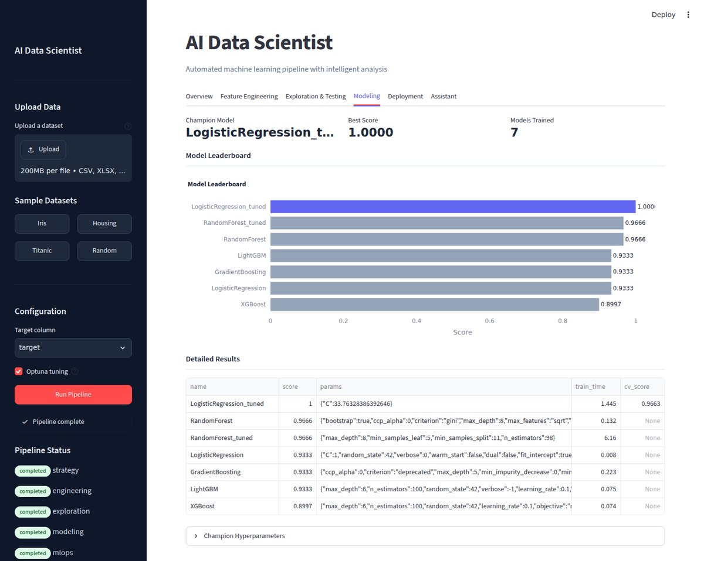
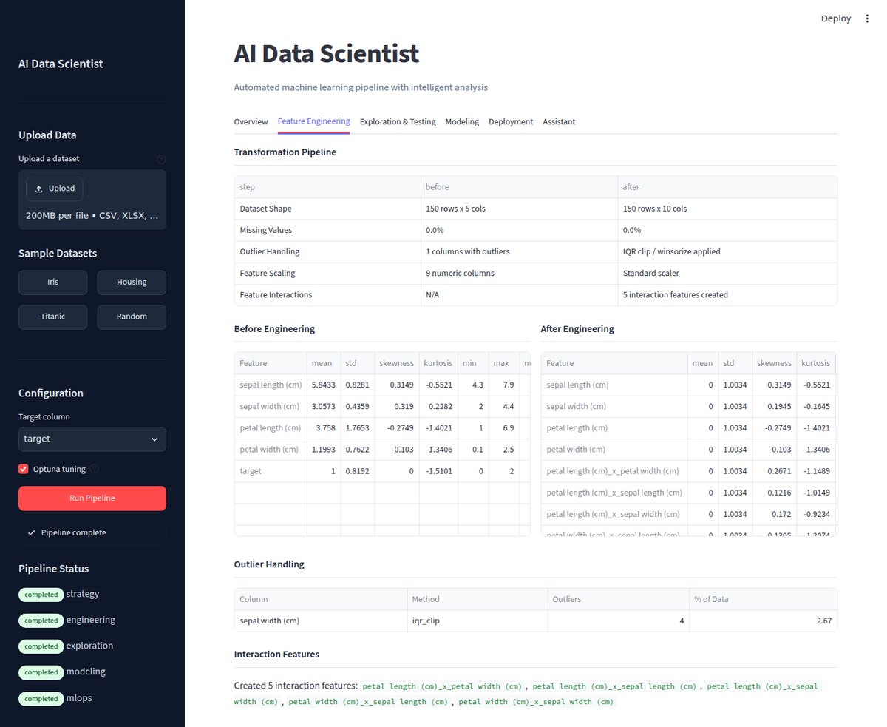
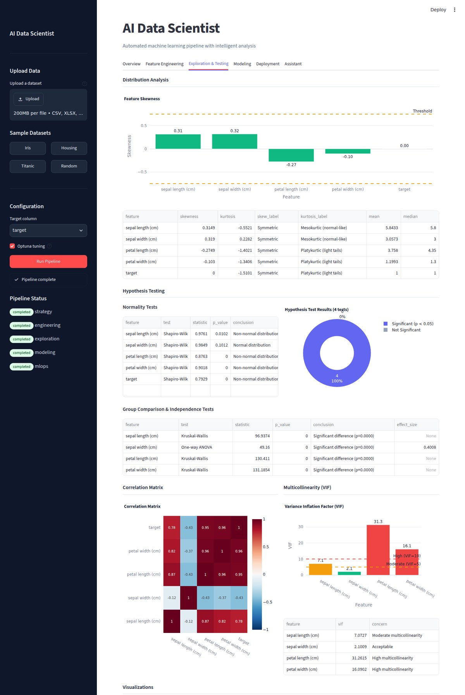
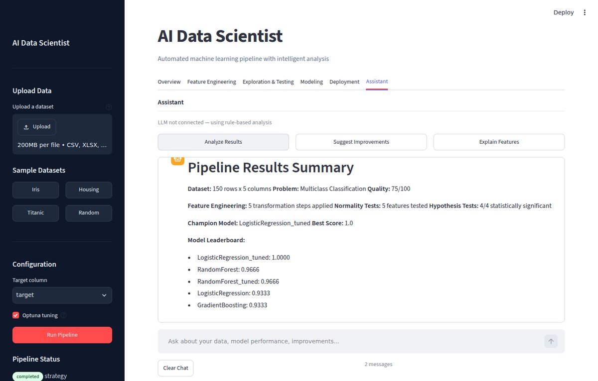
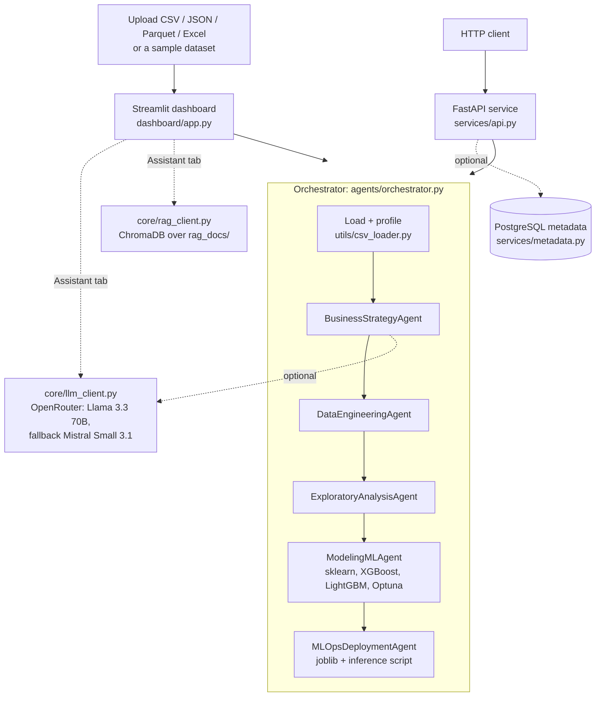

# AI Data Scientist Platform

**Give it a tabular dataset and a team of agents profiles it, frames the ML problem, engineers features, runs statistical tests, trains and tunes candidate models, and packages the champion, all visible in a Streamlit dashboard or callable through a FastAPI service.**

[](https://github.com/Akshatb848/data-science-agent-platform/actions/workflows/test.yml)
[](LICENSE)




<sub>Captured with headless Chromium from the dashboard running locally on the bundled <b>Iris</b> sample (150 rows),
with Optuna tuning on and no LLM key. Iris is an easy, tiny dataset and the hold-out split is only 30 rows, so the
scores say the pipeline works end to end, not that it is unusually accurate.</sub>

<details>
<summary><b>More screenshots</b> (feature engineering, statistical tests, assistant)</summary>

**Feature engineering report:** before/after statistics, outlier handling, interaction features



**Exploration & testing:** skewness, normality tests, ANOVA / Kruskal-Wallis, correlation, VIF



**Assistant** (rule-based mode, no API key)



</details>

A multi-agent pipeline that takes a tabular dataset and runs it end to end:
profiling, problem framing, feature engineering, statistical exploration, model
training and selection, and deployment packaging. An optional LLM
(via OpenRouter) and a ChromaDB knowledge base drive a chat assistant that can
answer questions about the run.

All LLM features are optional. If no API key is set, every step uses
deterministic, rule-based logic instead.

## What it does

1. **Ingest and profile.** Loads CSV, JSON, Parquet or Excel files. The CSV
   loader detects the encoding, delimiter, header and BOM, and handles bad lines.
   It then profiles the data: schema, missing values, a quality score, the likely
   target column and problem type, ID columns, datetime columns and possible
   leakage columns.
2. **Business strategy.** Turns the profile into an ML objective with primary and
   secondary KPIs, plus constraints (such as a small dataset, high missingness or
   ID/leakage columns) and recommendations.
3. **Data engineering.** Drops ID, leakage and mostly-empty columns. Imputes
   missing values (mean, median, KNN or mode), clips outliers (IQR or winsorize),
   corrects skew (Box-Cox, Yeo-Johnson or log1p) and encodes categoricals
   (label, one-hot or smoothed target encoding). It also adds interaction
   features, scales the data (standard or robust), applies PCA when there are
   more than 50 features, prunes features with mutual information, and makes a
   stratified 80/20 train/test split. The step writes a before/after report.
4. **Exploratory analysis.** Distribution metrics, normality tests
   (Shapiro-Wilk / D'Agostino), correlation significance, ANOVA, Kruskal-Wallis,
   chi-square, VIF multicollinearity checks and auto-generated chart specs.
5. **Modeling.** Trains Logistic/Linear Regression, Random Forest and Gradient
   Boosting, plus XGBoost and LightGBM when they are installed. Can tune the top
   two models with Optuna (up to 30 trials or 120 s each). Ranks the models on a
   leaderboard and picks a champion by test score: weighted F1 for classification,
   R² for regression. The champion also gets a cross-validation score.
6. **MLOps / deployment.** Saves the champion with joblib and generates an
   inference script, a monitoring config and deployment recommendations.

## Architecture



- Every agent subclasses `BaseAgent` (`agents/base.py`) and returns an
  `AgentResult(success, data, errors, metadata)`. The orchestrator keeps a state
  for each step (`pending`, `running`, `completed`, `failed` or `skipped`). If a
  step fails, the steps that depend on it are skipped rather than crashing the run.
- **Data flow.** The profile and DataFrame go to strategy, engineering and
  exploration. The train/test matrices from engineering go to modeling, and the
  champion model goes to MLOps.
- **LLM.** `LLMClient` calls Meta Llama 3.3 70B through OpenRouter and falls back
  to Mistral Small 3.1. `BusinessStrategyAgent` and the dashboard's Assistant tab
  use it. Without a key, both fall back to rule-based logic.
- **RAG.** `RAGClient` splits the markdown files in `rag_docs/` into chunks and
  indexes them in ChromaDB, using Chroma's default embedding function. The
  Assistant tab retrieves from this index. The dashboard builds the index on
  first run.
- **Metadata.** If `DATABASE_URL` is set, the API records datasets and
  experiments in PostgreSQL. Otherwise it runs without them.

## Tech stack

Python, pandas, NumPy, SciPy, statsmodels, scikit-learn, XGBoost, LightGBM, Optuna,
Streamlit, Plotly, FastAPI and Uvicorn, Pydantic, ChromaDB, the OpenAI Python SDK
(pointed at OpenRouter), psycopg2 (PostgreSQL) and pytest.

## Run locally

Requires Python 3.10+.

```bash
git clone https://github.com/Akshatb848/data-science-agent-platform.git
cd data-science-agent-platform
python -m venv .venv && source .venv/bin/activate   # Windows: .venv\Scripts\activate
pip install -r requirements.txt
cp .env.example .env    # optional: add your OpenRouter key / DATABASE_URL
```

Dashboard (main UI):

```bash
streamlit run dashboard/app.py
# Opens on port 5000 (set in .streamlit/config.toml): http://localhost:5000
```

API (optional):

```bash
python main.py            # uvicorn services.api:app on http://localhost:8000
# Interactive docs: http://localhost:8000/docs
```

Pre-build the RAG index (optional; the dashboard also does this on first run):

```bash
python setup_rag.py
```

### API endpoints

| Method | Path | Purpose |
|---|---|---|
| GET  | `/api/health` | Health check and version |
| POST | `/api/upload` | Upload a dataset file (multipart) |
| POST | `/api/pipeline/run` | Run the pipeline: `{"file_path": "...", "target_col": "..."}` |
| GET  | `/api/pipeline/state` | Status of each step |
| GET  | `/api/pipeline/step/{step_name}` | Result of one step (`strategy`, `engineering`, `exploration`, `modeling` or `mlops`) |
| GET  | `/api/datasets` | List recorded datasets (requires PostgreSQL) |
| GET  | `/api/experiments?dataset_id=` | List experiments for a dataset (requires PostgreSQL) |

## Configuration

All settings are environment variables and all are optional. See `.env.example`.
A `.env` file in the project root is loaded automatically.

| Variable | Default | Used for |
|---|---|---|
| `OPENROUTER_API_KEY` | unset | Turns on LLM features. Without it, rule-based fallbacks are used. |
| `OPENROUTER_BASE_URL` | `https://openrouter.ai/api/v1` | OpenRouter-compatible endpoint |
| `AI_INTEGRATIONS_OPENROUTER_API_KEY` / `_BASE_URL` | unset | Replit AI Integrations fallback, used if the two variables above are unset |
| `DATABASE_URL` | unset | PostgreSQL for experiment metadata (API only) |
| `UPLOAD_DIR` | `data/uploads` | Where the API stores uploads |
| `DEBUG` | `false` | App debug flag |

## Tests

```bash
pip install ruff
ruff check .
pytest -q
```

The suite covers the CSV loader, each agent, the orchestrator end to end, the
LLM client (env-var handling, and chat/fallback against a mocked client) and the
FastAPI endpoints (70 tests). It makes no network calls and needs no API key. CI
(`.github/workflows/test.yml`) runs Ruff and the suite on Python 3.10 and 3.11.

## Project structure

```
agents/              Orchestrator + 5 pipeline agents (base.py defines BaseAgent/AgentResult)
core/                LLM client (OpenRouter), RAG client (ChromaDB), Pydantic models
services/            FastAPI app (api.py) and PostgreSQL metadata service
dashboard/           Streamlit app and components (chat assistant, Plotly charts)
utils/csv_loader.py  Robust file loading and dataset profiling
config/settings.py   Environment-driven settings
rag_docs/            Markdown knowledge base indexed into ChromaDB
chroma_db/           Persisted ChromaDB index
tests/               pytest suite
docs/screenshots/    README images
main.py              Starts the FastAPI service
setup_rag.py         Builds the RAG index from rag_docs/
```

## Limitations

- Supports supervised tabular problems only: binary classification, multiclass
  classification and regression. The profiler also labels some datasets as time
  series or clustering, but no specialised models exist for either. Time-series
  data gets a random rather than chronological split.
- The pipeline runs in memory in a single process. The API keeps one global
  orchestrator, so concurrent pipeline runs overwrite each other's state.
- Models are scored on one 80/20 hold-out split, and Optuna tunes against that
  same split. The cross-validation score is computed on the training set.
- `MLOpsDeploymentAgent` writes models to `./models/` and only generates
  deployment artefacts. Nothing is deployed or served.
- The "housing" sample in the dashboard downloads the California Housing dataset
  through scikit-learn, so it needs internet access on first use.
- The API has no authentication, and CORS is open (`*`).
- `replit.md` and `.replit` are leftovers from the original Replit setup. They
  are not required to run the project locally.
- Running the dashboard rebuilds the ChromaDB index in `chroma_db/`, which is
  checked in, so a local run leaves those files modified.
- There is no Dockerfile yet; run it in a virtualenv as described above.

## License

[MIT](LICENSE) © 2026 Akshat Banga

## Author

**Akshat Banga** · [github.com/Akshatb848](https://github.com/Akshatb848)
